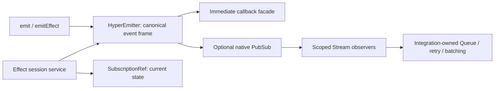

# Effect event system designs

Research date: 2026-10-14. Target: the workspace's installed Effect 4.0.2. This note distinguishes the inspected implementation below from further architectural recommendations. No tests, typechecks, builds, or benchmark runs were performed by this research agent.

The useful design is composition: HyperEmitter can own a PubSub for queued observers while preserving the existing synchronous callback API. PubSub, Queue, Stream, SubscriptionRef, and scoped fibers solve different responsibilities; making every callback a PubSub consumer would change callback timing and error behavior without delivering an equivalent public API.

## Inspected implementation status

The current HyperEmitter and public EventEmitter facade expose `pubsub(options?)` as a method returning the lazy native observation hub, `subscribe(options?)` as a scoped Effect subscription, and `stream(options?)` as a lazy Stream. `hasPubSub` and `pubsubStatus` expose feed availability and facade publication counters. The default is unbounded with replay 0; finite buffers require an explicit dropping/sliding strategy and capacity. Configuration is fixed when the hub is created, and raw publication addresses queued observers only. These details were read from `packages/hyperemitter/src/core/HyperEmitter.ts`, `EventEmitter.ts`, and `EmissionHub.ts`; this research agent did not independently run the parent agent's reported 27 focused API checks. This is source implementation status, not release evidence. The service, FiberSet, Queue, SubscriptionRef, and `Stream.share` designs below remain recommendations.

## Recommendation for the current change

Use one canonical emitter ingress that creates one event frame, publishes that frame to an optional observation hub, and invokes ordinary callbacks directly. Retain the callback facade's variadic arguments, wildcard matching, registration order, `this.event`, exception behavior, listener-result arrays, and listener-management helpers. These are responsibilities of the public facade and router; Effect PubSub supplies asynchronous broadcast storage and subscription lifecycle. This separation follows from PubSub's asynchronous broadcast contract, rather than from throughput comparisons. [PubSub documentation](https://effect.website/docs/v4/concurrency/pubsub).

Make PubSub lazy and opt-in, so ordinary callback users acquire no hub or persistent observer fibers. Once enabled, the hub can be the same native PubSub returned to advanced users. Offer a Stream or scoped subscription convenience API as the usual access path. `Stream.fromPubSub` already manages a subscription while its stream runs; consumers can filter, batch, and process through standard Stream operators instead of another custom worker abstraction. [Stream API](https://effect.website/docs/v4/api/effect/Stream).

The default observation hub should be unbounded with replay disabled. This preserves synchronous producer progress and retains queued observations for active subscribers. It does not bound memory if a subscriber remains alive and stops draining, so it is an explicit delivery tradeoff rather than a universal best default. Enable finite dropping or sliding buffers only when a caller selects that loss policy. A bounded lossless publisher must be allowed to suspend and therefore belongs in an Effect-native producer API or downstream integration queue. [PubSub documentation](https://effect.website/docs/v4/concurrency/pubsub).

## Responsibility map

| Responsibility | Primitive or owner | Practical consequence |
| --- | --- | --- |
| User-facing callbacks and EventEmitter2-style helpers | Public EventEmitter facade and HyperEmitter router | Keep synchronous dispatch, variadic payloads, ordering, wildcard matching, and result behavior. |
| Queued broadcast observation | One lazy PubSub per emitter | Each active subscription can observe the same events without serializing the public callbacks. |
| Filtering, batching, sequential or bounded concurrent consumption | Stream pipeline | An integration selects how its own work proceeds instead of changing all listeners. |
| One job distributed to one worker | Queue per worker group or integration | Multiple workers share work rather than all executing the same side effect. |
| Current readiness, pairing, or connection snapshot | SubscriptionRef inside the session service | A newly started observer gets current state as well as later transitions. |
| Session-owned lifetime and async listener cleanup | Scope, `Effect.forkIn`, or FiberSet | Closing a session cancels its work and subscriptions without closing the process-level global emitter. |
| Service dependencies and tracing | Context.Service, Layer, captured context or caller-context Effect execution | Resources and spans are passed deliberately rather than assumed to appear because an emitter uses Effect. |

The Queue/PubSub distinction is broadcast versus competing consumption: Queue removes a value for one consumer, while PubSub supplies it to each subscription. A queue take does not itself mean a webhook or database side effect completed. [Queue documentation](https://effect.website/docs/v4/concurrency/queue). State observation is a different contract again: SubscriptionRef exposes the current value and a stream of updates. [SubscriptionRef documentation](https://effect.website/docs/v4/state-management/subscriptionref).

This diagram describes the recommended composition. It does not prescribe a Queue for every observer or a rewrite of existing session state.

## Canonical ingress and direct PubSub access

`emit`, `emitEffect`, and `emitAsync` should pass through the same internal ingress exactly once. A queued envelope should carry the event name and original argument tuple, with payload identity preserved. It should not expose the facade's mutable listener-result collector. Publish an observation before invoking callbacks so a callback that recursively emits B during A does not make the queued observer see B before A. This is an implementation recommendation derived from reentrant callback semantics, not an Effect-provided ordering feature.

Keep `emit()`'s historical boolean tied to callback listener presence. A queued observer accepting an event is a separate result. Likewise, `emitAsync()` should await its selected callback results, not every arbitrary PubSub subscriber; native publication means acceptance by the hub, not application-side completion. Reliable processing acknowledgements belong to an integration protocol when an actual caller needs them. [PubSub API](https://effect.website/docs/v4/api/effect/PubSub).

Raw `PubSub.publish(hyperemitter.pubsub(), frame)` will reach queued subscribers, but it will not pass through HyperEmitter's direct callback dispatcher. Document direct raw publication as observation-hub publication. Users who want an event to reach both interfaces use the emitter ingress. Raw `PubSub.shutdown` also changes that hub's lifecycle; owning emitter shutdown should shut the hub down as well. [Effect 4.0.2 PubSub source](https://github.com/Effect-TS/effect/blob/269a7c864351231d42e6e95b7fa8f32050df3691/packages/effect/src/PubSub.ts).

Making raw publication also reach callbacks requires one of three changes: callbacks become queued consumers; the project supplies a custom intercepted PubSub implementation; or an extra hub consumer redispatches raw frames and deduplicates frames already dispatched directly. The first loses synchronous callback semantics; the latter two add machinery and origin bookkeeping. None is necessary for optional direct observation. This is a design inference, not a restriction on using PubSub.

Public PubSub operations have no subscriber-count accessor. Native subscriptions can bypass wrapper registration hooks, so global forwarding should treat an enabled observation hub as interest in all forwarded events. Do not inspect internal subscriber maps or turn a missing tracked callback into proof that the hub has no observers. This conservative rule can forward more events after the hub is enabled, which is a reasonable cost at the stated session volumes. [Effect 4.0.2 PubSub API/source](https://github.com/Effect-TS/effect/blob/269a7c864351231d42e6e95b7fa8f32050df3691/packages/effect/src/PubSub.ts).

## Buffer policy that fits synchronous emit

| Configuration | Synchronous ingress implementation | When it is appropriate |
| --- | --- | --- |
| Default unbounded, replay 0 | Native nonblocking publication | A caller wants all live observations and accepts backlog memory growth. |
| Explicit capacity with dropping | Native nonblocking publication and an independent drop counter | Missing new observations is acceptable when the observer falls behind. |
| Explicit capacity with sliding | Execute native effectful publication synchronously | A consumer values recent observations and accepts losing older ones. |
| Bounded lossless backpressure | Effectful publisher that can suspend | Producer progress may wait for consumers; this cannot be the promised synchronous callback `emit()` behavior. |

In installed 4.0.2, `PubSub.publishUnsafe` attempts atomic publication and returns false if no immediate space is available. It does not call the strategy's surplus handler. That means using it on a sliding hub does **not** evict an older value when full. The ordinary sliding `PubSub.publish` path uses a synchronous surplus handler, so `Effect.runSync(PubSub.publish(...))` is a valid boundary for that deliberately selected policy. A bounded backpressure publication can suspend, so applying the same `runSync` pattern there can fail. [PubSub API](https://effect.website/docs/v4/api/effect/PubSub), [running Effects](https://effect.website/docs/v4/getting-started/running-effects).

If finite configuration is added, require capacity and an explicit dropping/sliding strategy together. Do not fork one blocked bounded publication per synchronous emission: pending fibers then become an unbounded backlog outside the bounded hub. Keep drop reporting separate from historical `emit()` return values and callback errors. Replay should be an explicit small setting for transient observation; it is not durable event history.

The incompatible promises are immediate synchronous callback delivery, nonblocking producers, finite memory, and lossless queued delivery to arbitrarily slow active observers. A finite buffer cannot retain an indefinitely growing backlog. Select the tradeoff at the observer/integration boundary, without adding a gate to normal session progress.

## Other appropriate designs

### An Effect-native session service with a callback facade

For internal work that already runs in an Effect program, provide a session-scoped service with an effectful publish operation, event Stream, and state snapshot. Build its resources in a Layer; the process-level public `ev` remains a callback facade. This gives dependency injection a concrete home and keeps shutdown ownership per session. Merely invoking `Effect.runSync` around callback routing does not acquire the caller's database, logger, or trace context. [Managing services](https://effect.website/docs/v4/requirements-management/services), [managing Layers](https://effect.website/docs/v4/requirements-management/layers).

For Effect listeners registered from a synchronous callback boundary, `FiberSet.makeRuntime` or `FiberSet.runtime` provides a standard runner with the services captured when it is created and with fibers tracked in a scope. That is a more appropriate alternative to manually managing a separate set of spawned fibers. It still creates fibers and needs a failure policy; it does not make arbitrary JavaScript promises interruptible. [FiberSet API](https://effect.website/docs/v4/api/effect/FiberSet), [Effect 4.0.2 FiberSet source](https://github.com/Effect-TS/effect/blob/269a7c864351231d42e6e95b7fa8f32050df3691/packages/effect/src/FiberSet.ts).

Future typed Effect listeners should preserve their service requirement type, or deliberately capture and provide their registration context. A type that only accepts `Effect<unknown, unknown>` promises no external requirements. Extending that type without providing a context would create a runtime service failure, not useful Effect integration.

### A shared Stream when the upstream is already a Stream

If transport events are converted into an Effect Stream, `Stream.share` already supplies multicast with capacity, replay, and buffer strategy. It starts upstream with the first consumer and finalizes it after the last leaves; an idle lifetime can retain it temporarily. This can remove custom dispatcher-worker infrastructure. `Stream.broadcastN` fits a known fixed set of consumers and establishes all branches before starting upstream. Neither operator restores immediate callback semantics by itself, so this is an internal transport/service design, not a direct replacement for public `ev.emit`. [Effect 4.0.2 Stream source](https://github.com/Effect-TS/effect/blob/269a7c864351231d42e6e95b7fa8f32050df3691/packages/effect/src/Stream.ts).

### Per-integration Queue and error policy

Use a Queue when several workers should divide webhook or persistence work. Give separate integrations their own queue and concurrency policy; otherwise one slow endpoint can become everyone's backlog. One sequential worker preserves processing order. Multiple workers can finish out of order even if values were dequeued in order. Queue acceptance remains separate from completion, persistence, and redelivery. [Queue documentation](https://effect.website/docs/v4/concurrency/queue), [Effect 4.0.2 Queue source](https://github.com/Effect-TS/effect/blob/269a7c864351231d42e6e95b7fa8f32050df3691/packages/effect/src/Queue.ts).

Retry the handler for the current event inside the consumer, with a bounded Schedule and a deliberate exhausted-retry action. Applying `Stream.retry` to the entire hot subscription restarts the subscription; it is not an acknowledgement or replay guarantee for the event that failed. Retrying side effects still needs domain-level idempotency. If a processing failure terminates a subscriber, close its scope so it does not remain registered and retain backlog. [Stream error handling](https://effect.website/docs/v4/stream/error-handling).

### SubscriptionRef for current session state

A late-starting readiness observer needs the current connection state, not only future `connection.changed` events. SubscriptionRef is a suitable session-owned state source because its stream starts with the current snapshot. It should not replace discrete message/ACK events. In 4.0.2 it internally uses an **unbounded** PubSub with replay 1, so it is not automatically a memory-bounded latest-value mailbox for an active slow observer. Updates are serialized, but consumer lag still needs an appropriate observation pipeline. [SubscriptionRef documentation](https://effect.website/docs/v4/state-management/subscriptionref), [Effect 4.0.2 SubscriptionRef source](https://github.com/Effect-TS/effect/blob/269a7c864351231d42e6e95b7fa8f32050df3691/packages/effect/src/SubscriptionRef.ts).

### One hub per emitter first; topic hubs when isolation matters

A single hub per session/emitter is the simplest starting point and supports wildcard observers by filtering frames. With finite lossless backpressure, one slow subscriber controls progress for every event carried on that hub, even if it only cares about a subset. Per-topic hubs can isolate those policies, but wildcard observation then needs composition and a documented cross-topic ordering contract. Split by actual delivery requirements before building a general topic registry. This is a design inference from bounded broadcast semantics. [PubSub documentation](https://effect.website/docs/v4/concurrency/pubsub).

Avoid routing every session through one bounded process-level hub. Keep each session's work in its own scope, and use global `ev` for the existing cross-session API. Ending one session removes its bridge; it must not shut down all sessions' global subscribers.

## Lifecycle and trace behavior

Native subscriptions are scoped. Subscriber fibers belong to consumer or session scopes; a global hub belongs to the global emitter's owner. Close or interrupt these resources deliberately. PubSub shutdown interrupts waiters and finalizes subscriptions; it is not a promise that already buffered integration work drained successfully. Graceful drain belongs to the integration that asks for it, not a new universal session shutdown barrier. [Scope documentation](https://effect.website/docs/v4/resource-management/scope).

An async queue boundary does not automatically transfer the publisher's current span to a persistent consumer fiber. If event processing should be causally linked, carry the required trace metadata with the event and deliberately start/link a consumer span. Capturing service context when a consumer is registered supplies its dependencies; it does not identify the producer of every later event. [Tracing in Effect](https://effect.website/docs/v4/observability/tracing).

## Implementation priorities

1. Keep the public callback facade and put lazy PubSub observation behind the same ingress. Preserve arguments and callback behavior; publish a separate immutable envelope rather than the result collector.
2. Expose native PubSub plus a scoped Stream/subscription convenience. State explicitly that raw publication targets queued observers and that the historical async emitter API awaits callbacks.
3. Start with unbounded/no replay and optional explicit dropping/sliding observation policies. Do not add pending-publisher fibers or session gates to simulate lossless finite storage beneath synchronous emit.
4. Use standard Effect consumers for integrations that need ordering, batching, retries, or bounded concurrency. Add a Queue or SubscriptionRef only where that responsibility exists.
5. If internal transport becomes a Stream, evaluate `Stream.share` and a typed session service before inventing another dispatcher. Use service/scoped execution when it yields concrete dependency and cleanup benefits.

The architectural decision is driven by API semantics and ownership. The existing completed-delivery benchmarks are useful evidence about the cost of the individual paths, but they do not require choosing only one of them.

## Source provenance

The installed package reports 4.0.2. Git tag `effect@4.0.2` resolves to `269a7c864351231d42e6e95b7fa8f32050df3691`; source citations above pin that commit. The live website API currently advertises 4.0.4, so version-sensitive publication, subscription, scope, FiberSet, state-ref construction, and Stream behavior was also read from local 4.0.2 source and the pinned tag. Local source includes expanded documentation/formatting; relevant PubSub/FiberSet execution logic matches the pinned tag. The read-only investigation did not change installed packages.
